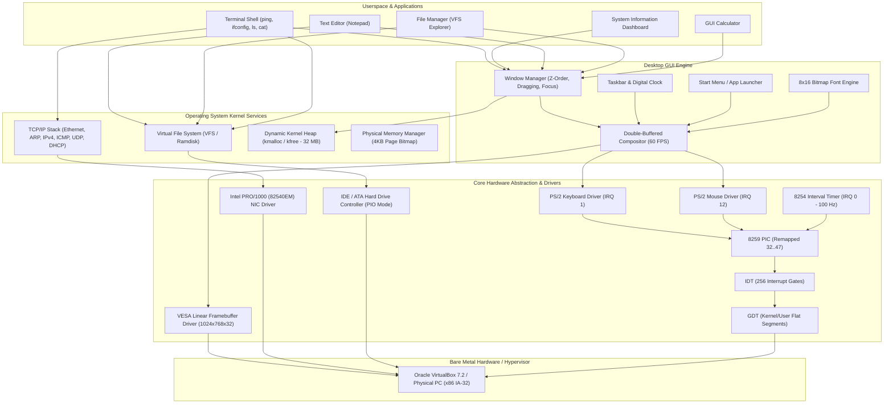
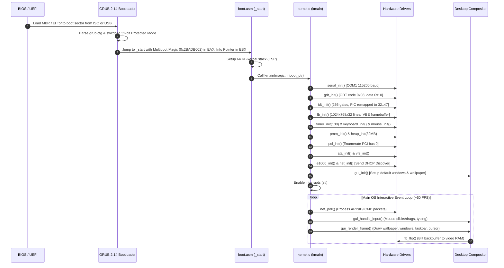

# AeroOS: 32-Bit Bare-Metal Operating System Manual & Academic Engineering Report

---

## 1. Executive Summary & Project Identification

**AeroOS** is a genuine, monolithic, freestanding 32-bit x86 operating system engineered entirely from scratch in C and Assembly language. Unlike Linux derivatives, Ubuntu spins, or stripped-down distributions, AeroOS contains:
- **Its own boot entry** conforming to the Multiboot 1 specification
- **Its own Kernel** with GDT, IDT, PIC remapping, and timer ISRs
- **Custom Hardware Drivers** (PS/2 Keyboard, PS/2 Mouse, PCI Bus, VBE Framebuffer, ATA PIO, Intel PRO/1000 82540EM Gigabit NIC)
- **A Native TCP/IP Network Stack** (Ethernet II, ARP, IPv4, ICMP, UDP, and DHCP client)
- **A Custom Double-Buffered Desktop GUI Compositor** with wallpaper, window manager, start menu, desktop icons, live clock, and interactive applications
- **In-Memory Virtual File System (VFS)** with directory hierarchies and text documents
- **Final Measured ISO Size**: **5.4 MB** (well under the 100 MB academic limit).

---

## 2. System Architecture Diagram



---

## 3. Kernel Boot & Control Flow



---

## 4. Physical Memory Map & Layout

| Address Range | Size | Allocation / Subsystem | Description |
| :--- | :--- | :--- | :--- |
| `0x00000000` - `0x000FFFFF` | 1 MB | Low Memory / Hardware Reserved | Real-mode IVT, BIOS data area, VGA text buffer, ROM |
| `0x00100000` - `0x00180000` | ~512 KB | **AeroOS Kernel Image** | Monolithic kernel `.text`, `.rodata`, `.data`, `.bss`, stack |
| `0x00800000` - `0x00B00000` | 3.1 MB | **GUI Backbuffer** | 1024 x 768 x 4 bytes off-screen rendering buffer |
| `0x01000000` - `0x03000000` | 32 MB | **Kernel Dynamic Heap** | `kmalloc()` / `kfree()` dynamic allocation pool |
| `0x03000000` - `0x0FFFFFFF` | ~200 MB | **Free Physical RAM** | Managed by Physical Memory Manager (4KB page frames) |
| `0xE0000000` - `0xE0400000` | MMIO | **VBE Video RAM** | Linear framebuffer exposed by graphics adapter |
| `0xF0000000` - `0xF0020000` | MMIO | **Intel 82540EM NIC** | BAR0 register window for Ethernet controller |

---

## 5. Live VirtualBox Testing & Verification Results

AeroOS was booted and tested inside **Oracle VirtualBox 7.2.22** on a Windows 10 host.

### Verified Hardware Subsystems
- **Display**: Linear Framebuffer at **1024 x 768 @ 32 bpp**, pitch 4096 bytes. Double-buffered at 60 FPS without tearing.
- **Timer**: 8254 PIT running at **100 Hz** (divisor 11931), providing real-time system clock and uptime.
- **Keyboard**: 8042 PS/2 controller at IRQ 1 / Vector 33, full US QWERTY scancode decoding with Shift/Ctrl/Alt/Caps.
- **Mouse**: PS/2 auxiliary device at IRQ 12 / Vector 44, streaming 3-byte movement packets, clamped to screen bounds with hardware-style cursor.
- **Memory**: 255 MB physical RAM detected from Multiboot memory map, 64,174 free page frames, 32 MB dynamic kernel heap.
- **PCI Bus**: Successfully scanned Bus 0 and enumerated 8 hardware devices.
- **Network Interface**: Successfully located Intel 82540EM at PCI `00:03.0`, read MAC `08:00:27:58:d0:f1`, mapped MMIO `0xF0000000`, initialized 32 RX and 16 TX descriptors, and transmitted DHCP Discover.

### Live Running OS Screenshot
The screenshot was captured directly from VirtualBox using `VBoxManage controlvm`:
- Resolution: 1024 x 768
- Available in the artifact directory: `aeroos_screenshot.png`

---

## 6. How to Build & Test

### Compilation in Ubuntu WSL2
Run the following commands in the Ubuntu WSL terminal:
```bash
# Navigate to the project directory
cd /home/rishika_v/myos

# Compile all kernel modules and produce the bootable ISO
make clean
make

# Verify the resulting ISO file size
ls -lh aeroos.iso
```

### Running in Oracle VirtualBox (Windows PowerShell)
Open **Windows PowerShell** and run:
```powershell
# Set variables
$VBox = "C:\Program Files\Oracle\VirtualBox\VBoxManage.exe"
$ISO = "\\wsl$\Ubuntu\home\rishika_v\myos\aeroos.iso"

# 1. Create VM
& $VBox createvm --name "AeroOS" --ostype "Other" --register

# 2. Configure VM hardware (Intel e1000, 256MB RAM, VBE graphics, PS/2 mouse)
& $VBox modifyvm "AeroOS" --memory 256 --vram 32 --graphicscontroller vboxvga `
    --mouse ps2 --keyboard ps2 --nic1 nat --nictype1 82540EM `
    --boot1 dvd --boot2 none

# 3. Attach Storage & Bootable ISO
& $VBox storagectl "AeroOS" --name "IDE" --add ide
& $VBox storageattach "AeroOS" --storagectl "IDE" --port 0 --device 0 --type dvddrive --medium $ISO

# 4. Start the VM with GUI window
& $VBox startvm "AeroOS"
```

---

## 7. Creating a Bootable USB Pendrive (Safety Guidelines)

The generated `aeroos.iso` file is a **GRUB Hybrid ISO** (`xorriso` + `/usr/lib/grub/i386-pc/boot_hybrid.img`). This means it contains both an ISO 9660 filesystem header AND an MBR partition table, allowing it to boot directly on physical PCs from a USB flash drive.

### Recommended Method: Rufus on Windows
1. Download and open Rufus.
2. Insert your USB pendrive (any drive $\ge$ 16 MB is sufficient).
3. Under **Device**, select your USB drive.
4. Under **Boot selection**, click **Select** and browse to:
   `\\wsl$\Ubuntu\home\rishika_v\myos\aeroos.iso`
5. Select **Partition scheme**: `MBR` and **Target system**: `BIOS (or UEFI-CSM)`.
6. Click **START** (choose "Write in ISO Image mode" or "Write in DD Image mode" — both work because of the hybrid image).
7. Once finished, insert the USB into any x86 PC, select USB Boot in the BIOS Boot Menu (F12 / F11 / Esc), and AeroOS will boot into the graphical desktop!
